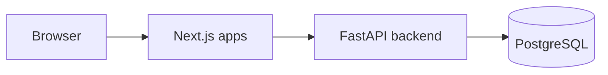
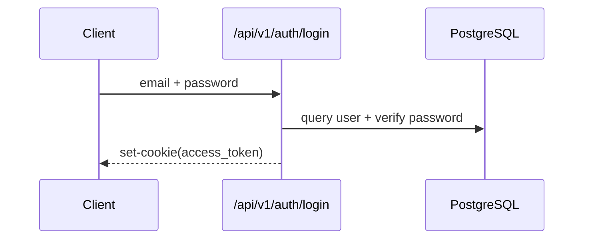
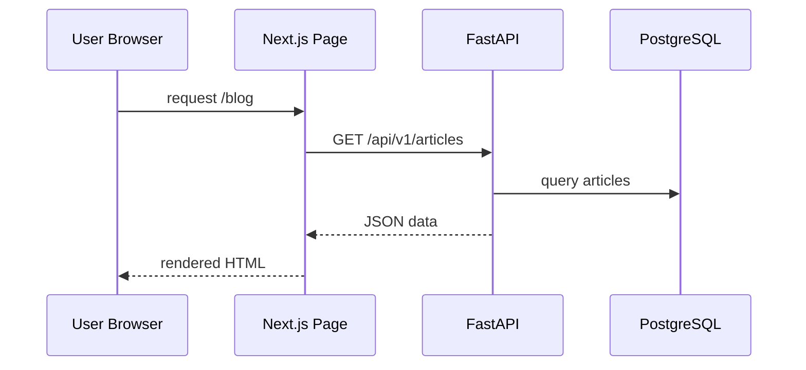

# 架构设计

## 总览

项目采用前后端分离:

- 前端: Next.js 16 App Router
- 后端: FastAPI + SQLAlchemy Async
- 数据库: PostgreSQL

## 分层设计

### 前端层

- 公共页面: 首页 / 博客 / 项目 / 简历
- 管理页面: admin 下内容管理与用户管理
- 数据访问:
  - 公共页面在 Server Component 中直接 fetch 后端
  - 管理页面通过 `lib/admin-api.ts` 请求后端

### 后端层

- 路由层: `app/api/v1/*`
- 认证层: `app/auth.py`
- 数据层: `app/models/*` + `app/database.py`

## 关键数据流

### 登录流程

### 内容读取流程

## 当前架构不足

- API 基地址仍有硬编码点，配置隔离不足
- 路由层承担了较多业务逻辑，后续可抽取 service/repository
- 缺少缓存层与异步任务队列

## 演进建议

1. 统一 API 地址到环境变量
2. 增加 service/repository 层
3. 引入缓存 (Redis)
4. 引入任务队列处理耗时操作
